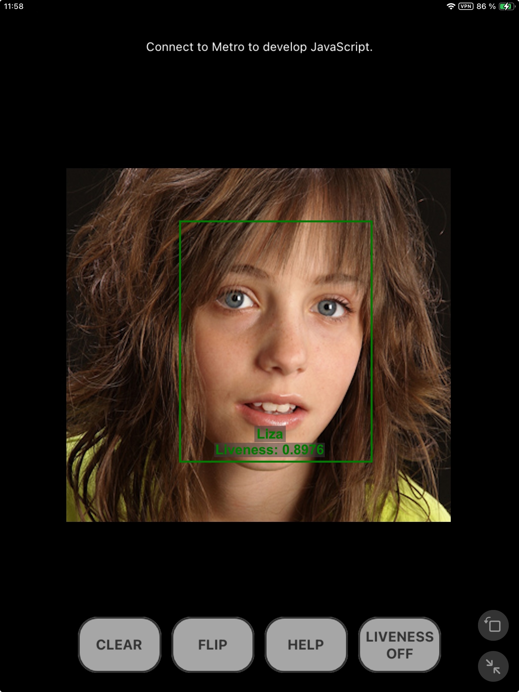
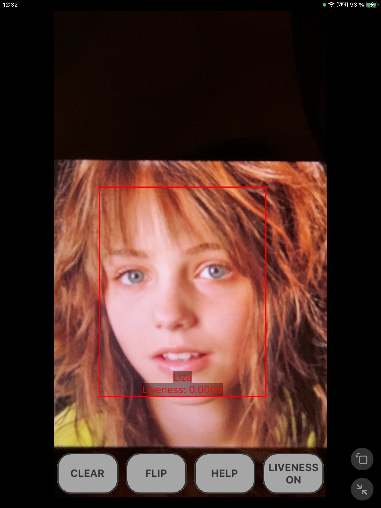

## [FaceSDK](https://www.luxand.com/facesdk/?utm_source=github&utm_medium=readmd&utm_campaign=header) · [CloudAPI](https://luxand.cloud/?utm_source=github&utm_medium=readmd&utm_campaign=header) · [LinkedIn](https://www.linkedin.com/company/luxand-inc.) · [Contact](mailto:support@luxand.com)


### NIST-approved

Luxand's FaceSDK ranked within the top 21.8% by the National Institute of Standards and Technology (NIST) during the Face Recognition Vendor Test (FRVT).


### iBeta Certified Liveness

The iBeta certified Liveness add-on for FaceSDK aced Level 1 Presentation Attack Detection (PAD) testing, following ISO/IEC 30107-3 standards.

# FaceSDK \- React Native (iOS, Android)

##  

## Installation

```bash
npm install react-native-facesdk react-native-nitro-modules
```

`react-native-nitro-modules` is a required peer dependency &mdash; the wrapper is a [Nitro module](https://nitro.margelo.com/) and will not load without it.

For iOS, install the pods:

```bash
cd ios && pod install
```

### Camera support (optional)

Frame processing is only needed if you feed camera frames to the Tracker. It requires three further peer dependencies:

```bash
npm install react-native-vision-camera react-native-vision-camera-worklets react-native-worklets
```

Add the Worklets Babel plugin to `babel.config.js`:

```js
module.exports = {
  presets: ['module:@react-native/babel-preset'],
  plugins: ['react-native-worklets/plugin'],
};
```

These are declared as optional peer dependencies, so still-image use does not pull them in.

### Requirements

| | |
| :--- | :--- |
| React Native | 0.85 or newer (New Architecture only) |
| Android | minSdk 26, NDK 28.2.13676358, CMake |
| iOS | `min_ios_version_supported` |

## Usage

Everything is reachable through the default export.

```ts
import FSDK from 'react-native-facesdk';

FSDK.ActivateLibrary('INSERT THE LICENSE KEY HERE');
FSDK.Initialize();

const image = FSDK.LoadImageFromFile(path);
const face = image.detectFace();
const template = image.getFaceTemplate();

image.free();
```

Errors raise an `FSDK.Error` by default. `FSDK.SetOnError` chooses how they surface:

```ts
FSDK.SetOnError(FSDK.ON_ERROR.THROW);   // default — raises FSDK.Error
FSDK.SetOnError(FSDK.ON_ERROR.ALERT);   // shows an alert, returns a default value
FSDK.SetOnError(FSDK.ON_ERROR.SILENT);  // returns a default value

try {
  FSDK.ActivateLibrary(key);
} catch (error) {
  if (error instanceof FSDK.Error) console.warn(error.errorCode, error.message);
}
```

### Threads

```ts
FSDK.SetNumThreads(count: number): void;
FSDK.GetNumThreads(): number;
```

*Limits how many threads the SDK uses. Pass 0 to let it decide.*

### Writable directories

`FSDK.DocumentsDirectory` persists across launches; `FSDK.CachesDirectory` may be purged by the system.

```ts
tracker.saveToFile(`${FSDK.DocumentsDirectory}/tracker`);
```

## Face Detection and Recognition

```ts
export interface Point {
  x: number;
  y: number;
}

export interface Face {
  score: number;
  angle: number;
  bbox: { p0: Point; p1: Point };
  features: Point[];
}
```

*Points `p0` and `p1` are the top left and bottom right corners of the face bounding box. `features` contains 5 points detected on the face: eye centers, nose and mouth corners.*

```ts
image.detectFace(): Face;
```

*Detects a single face on the image. If multiple faces are present, returns the one with the highest score.*

```ts
image.detectMultipleFaces(maxFaces?: number): Face[];
```

*Detects multiple faces, sorted by score in descending order.*

```ts
image.detectFacialAttributeUsingFace(face: Face, ...attributes): { ... };
image.detectFacialAttributeUsingFaceRaw(face: Face, attribute, maxSize?): string;
```

*Detects facial attribute values for a face returned by `image.detectFace`. The
`...UsingFeatures` variants take the 70 key points instead.*

```ts
image.getFaceTemplate(): FaceTemplate;
image.getFaceTemplateInRegion(face: Face): FaceTemplate;
```

*Obtains a face template &mdash; for the highest-scoring face, or for a given `face`.*

A face template is **1040 bytes**. Templates written by an earlier release of FaceSDK cannot be
read by this one &mdash; those calls fail with `ERROR.UNSUPPORTED_TEMPLATE_VERSION`.

`template.match` returns a similarity that is always in the range [0, 1], where 0.5 means
"unrelated". A threshold of 0.64 gives good results in our tests.

A `FaceTemplate` can be read as either a base64 string or an `ArrayBuffer`, and created from either:

```ts
const stored = template.asBase64();
const restored = FSDK.FaceTemplate.FromBase64(stored);

const similarity = template.match(restored);
```

### Configuration

Parameters are set with `FSDK.SetParameter` or `FSDK.SetParameters` (see the [documentation](https://www.luxand.com/facesdk/documentation/configuration.php)).

#### Face Detection

| Parameter | Description | Default Value | Accepted Values |
| :--- | :--- | :---: | :--- |
| FaceDetectionModel | Path to the face detection model file to load | default | File path or the string `"default"` |
| FaceDetectionThreshold | Face detection threshold | 0.64 | Floating point value from the range [0, 1] |
| FaceDetectionBatchSize | Number of image patches processed at the same time for face detection | 1 | Positive integer |
| FaceDetectionPatchSize | Size of a single image patch | the model's own input size | Positive integer. Higher values decrease performance, but allow detection of smaller faces |
| FaceDetectionPatchMode | Image patching algorithm to use | fast | <p>`"fast"` &mdash; resizes the image to `FaceDetectionPatchSize` and performs detection on a single patch</p> <p>`"full"` &mdash; splits the image into overlapping patches of size `FaceDetectionPatchSize` and performs detection on every patch separately combining the results afterwards</p> <p>`"mixed"` &mdash; if the image size is at least twice as big as `FaceDetectionPatchSize` chooses `"full"` otherwise chooses `"fast"`</p> |
| FaceDetectionBigFaceSize | Faces larger than this are detected on a downscaled copy of the image | 384 | Positive integer |
| TrimOutOfScreenFaces | Discard faces whose bounding box falls partly outside the image | true | `"false"` or `"true"` |
| FaceDetectionComputationDelegate | Computation delegate to use for face detection | cpu | <p>`"none"` &mdash; run on CPU without SIMD optimizations</p> <p>`"cpu"` &mdash; run on CPU with SIMD optimizations</p> <p>`"gpu"` &mdash; run on GPU</p> <p>`"nnapi"` &mdash; run using [NNAPI](https://developer.android.com/ndk/guides/neuralnetworks)</p> |
| FaceDetectionNumThreads | Number of threads used for face detection | chosen automatically | Positive integer |

#### Face Recognition

| Parameter | Description | Default Value | Accepted Values |
| :--- | :--- | :---: | :--- |
| FaceRecognitionModel | Path to the face recognition model file to load | default | File path or the string `"default"` |
| FaceRecognitionUseFlipTest | Additionally use mirrored image when creating face template | false | `"false"` or `"true"` |
| FaceRecognitionBatchSize | Number of faces processed at the same time for face recognition | 1 | Positive integer |
| FaceRecognitionComputationDelegate | Computation delegate to use for face recognition | cpu | <p>`"none"` &mdash; run on CPU without SIMD optimizations</p> <p>`"cpu"` &mdash; run on CPU with SIMD optimizations</p> <p>`"gpu"` &mdash; run on GPU</p> <p>`"nnapi"` &mdash; run using [NNAPI](https://developer.android.com/ndk/guides/neuralnetworks)</p> |
| FaceRecognitionNumThreads | Number of threads used for face recognition | chosen automatically | Positive integer |

#### Facial Features

| Parameter | Description | Default Value | Accepted Values |
| :--- | :--- | :---: | :--- |
| FacialFeaturesModel | Path to the facial feature model file to load | default | File path or the string `"default"` |
| FacialFeaturesComputationDelegate | Computation delegate to use for facial feature detection | cpu | <p>`"none"` &mdash; run on CPU without SIMD optimizations</p> <p>`"cpu"` &mdash; run on CPU with SIMD optimizations</p> <p>`"gpu"` &mdash; run on GPU</p> <p>`"nnapi"` &mdash; run using [NNAPI](https://developer.android.com/ndk/guides/neuralnetworks)</p> |
| FacialFeaturesNumThreads | Number of threads used for facial feature detection | chosen automatically | Positive integer |

`ComputationDelegate` and `ModelNumThreads` set the delegate and the thread count for every model
at once, overriding the per-model parameters above.

## iBeta Certified Liveness Add-on

This package bundles the [iBeta Certified Liveness add-on](https://www.luxand.com/facesdk/documentation/certifiedliveness.php): the plugin binaries for all four Android ABIs, the iOS framework, and the model data (~26 MB per platform).

Initialize it once, after `FSDK.Initialize()`:

```ts
FSDK.ActivateLibrary(key);
FSDK.Initialize();
FSDK.InitializeIBeta();
```

`InitializeIBeta` copies the bundled models into `FSDK.CachesDirectory` and points the SDK at them. Files already present are skipped, so only the first call does real work &mdash; and it is synchronous, so that call takes noticeably longer than later ones.

### Reading liveness

With the add-on active the Tracker reports two further attributes alongside `Liveness`:

| Attribute | Meaning |
| :--- | :--- |
| `LivenessError` | Present when liveness could not be determined; the value describes why |
| `ImageQuality` | Quality of the frame used for the decision. Low values mean the result is unreliable |

```ts
const { Liveness } = tracker.getFacialAttribute(id, 'Liveness');
const { LivenessError } = tracker.getFacialAttribute(id, 'LivenessError');
const { ImageQuality } = tracker.getFacialAttribute(id, 'ImageQuality');
```

An attribute that has not been detected is reported as an error, which by default raises `FSDK.Error`, so read each one inside its own `try`/`catch`.

### Tracker parameters

The add-on produces a score per frame, so smoothing only delays the result:

```ts
tracker.setParameter('DetectLiveness', true);
tracker.setMultipleParameters({
  SmoothAttributeLiveness: false,
  LivenessFramesCount: 1,
});
```

The sample enables the add-on through `USE_IBETA_LIVENESS_ADDON` in `example/src/faces_processor.ts`. Setting it to `false` falls back to the simpler built-in liveness model.

## Managing Face Templates in Tracker Memory

The following functions can be used to synchronize Tracker Memory between different devices.

Since the list of IDs in the Tracker may change during operation (for example, two IDs may be merged), it is not recommended to work with the Tracker (i.e. call `tracker.feedFrame`) while using the following functions. Also, you must call the following function beforehand (see [FAQ](https://www.luxand.com/facesdk/faq.php)):

```ts
tracker.setParameter('VideoFeedDiscontinuity', [0]);
```

*The value is the list of camera indices whose frame history should be dropped, not a flag. Pass
`[0]` when you feed a single camera.*

Below is the list of functions for direct access to the Tracker Memory face templates.

```ts
tracker.getIDsCount(): number;
```

*Returns the number of `IDs` (persons) in the Tracker's database.*

```ts
tracker.getAllIDs(): number[];
```

*Returns a list of all the `IDs` in the Tracker.*

```ts
tracker.getIDByFaceID(faceID: number): number;
```

*Returns the person `ID` for the given `FaceID`. This function may be useful when the person `ID` changes during Tracker operation while the `FaceID` of the template remains unchanged, or when the `ID` is simply unknown. The `FaceID` always remains unchanged.*

```ts
tracker.getFaceIDsCountForID(id: number): number;
```

*Returns the number of face templates in the Tracker's database for the specified `ID` (person).*

```ts
tracker.getFaceIDsForID(id: number): number[];
```

*Returns a list of all the `FaceIDs` for the specified `ID` (person).*

```ts
tracker.getFaceTemplate(faceID: number): FaceTemplate;
```

*Returns the face template for the specified `FaceID`.*

```ts
tracker.getEyes(id: number, index?: number): Point[];
```

*Returns the two eye centres detected for an `ID`. Cheaper than `tracker.getFacialFeatures`, which
returns all 70 key points.*

```ts
tracker.createID(template: FaceTemplate): TrackerID;
```

*Creates a new person `ID` and adds the provided template to it. Returns the new person `ID` and the associated `FaceID`.*

```ts
tracker.addFaceTemplate(id: number, template: FaceTemplate): number;
```

*Adds a new template to an existing person `ID` and returns the `FaceID` assigned to it.*

```ts
tracker.deleteFace(faceID: number): void;
```

*Deletes the face template with the specified `FaceID`. If this is the last template for the person, the person `ID` will also be removed.*

```ts
tracker.getFaceImage(faceID: number): Image;
```

*Returns the face image for the specified `FaceID`. The dimensions are 112x112. Face images are stored when the `KeepFaceImages` Tracker parameter is `true`.*

```ts
tracker.setFaceImage(faceID: number, image: Image): void;
```

*Sets the face image for the specified `FaceID`. The dimensions of the provided `Image` must be 112x112. If an image already exists for the `FaceID`, it will be replaced.*

```ts
tracker.deleteFaceImage(faceID: number): void;
```

*Deletes the face image for the specified `FaceID` from the Tracker's database. If no image is present, the function does nothing.*

```ts
export interface IDSimilarity {
  id: number;
  similarity: number;
}

tracker.matchFaces(template: FaceTemplate, threshold: number, maxSize?: number): IDSimilarity[];
```

*Returns person `IDs` from the Tracker's memory whose face `similarity` score is above `threshold`, in descending order of similarity.*

## Camera Frame Processing

Frames are fed to the Tracker from a VisionCamera frame processor. Inside a worklet the wrapper's class API is unavailable, so calls go through the raw binding, `FSDK.Native`:

```ts
import FSDK from 'react-native-facesdk';
import { useFrameOutput } from 'react-native-vision-camera';
import { scheduleOnRN } from 'react-native-worklets';

const FSDKNative = FSDK.Native;

function onFaceIDs(ids: number[]) {
  // back on the React Native thread
}

const frameOutput = useFrameOutput({
  pixelFormat: 'rgb',
  enablePhysicalBufferRotation: true,
  onFrame(frame) {
    'worklet';

    const loaded = FSDKNative.LoadImageFromFrame(
      planes(frame),
      frame.pixelFormat,
      frame.width,
      frame.height
    );

    if (loaded.errorCode === FSDKNative.ERROR.OK) {
      const fed = FSDKNative.FeedFrame(tracker, 0, loaded.value, 4);

      if (fed.errorCode === FSDKNative.ERROR.OK)
        scheduleOnRN(onFaceIDs, fed.value);

      FSDKNative.FreeImage(loaded.value);
    }

    frame.dispose();
  },
});
```

Two constraints apply inside a worklet, and both fail at runtime rather than at build time:

- **Classes cannot be captured.** `FSDK`, `FSDK.Tracker` and your own classes are `undefined` there. Capture the binding at module scope, as `FSDKNative` above, and pass handles and plain values as arguments.
- **Methods cannot be detached.** `FSDKNative.FeedFrame` resolves its native instance from `this`, so `const FeedFrame = FSDKNative.FeedFrame` throws when called.

`LoadImageFromFrame` accepts RGB, RGBA, BGRA and planar YUV frames, converting where the SDK cannot read the layout directly. See `example/src/faces_processor.ts` for the full pipeline.

## Running the sample

Before you start, ensure you have the following installed on your machine:

- Node.js 22.11 or newer (https://nodejs.org). `.nvmrc` pins the version the sample is tested with
- yarn (`npm install -g yarn`)
- Xcode, and CocoaPods (for iOS development)
- Android SDK with CMake and NDK v28.2.13676358

Install the dependencies from the repository root:

```bash
yarn install
```

Replace `INSERT THE LICENSE KEY HERE` with your license key in `example/src/faces_processor.ts`.

### Android

```bash
yarn example android
```

Alternatively, open `example/android` in Android Studio and run from there.

**Note**: Before running the app on a real device, ensure that your device has USB Debugging enabled and is set to "File Transfer" mode.

### iOS

Install the CocoaPods dependencies first. `example/Gemfile` pins the versions of CocoaPods and its
dependencies that this sample builds with, so run it through Bundler:

```bash
cd example
bundle install
cd ios && bundle exec pod install
```

Then, for the simulator:

```bash
yarn example ios
```

**On a real device** `run-ios` needs to be told which one, otherwise it launches a simulator:

```bash
yarn example ios --list-devices     # look up the device
yarn example ios --device           # first connected device
yarn example ios --udid <UDID>      # a specific one
```

Alternatively, open `example/ios/FacesdkExample.xcworkspace` in Xcode (it only exists after
`pod install`), select a target device and run.

**Code signing.** The project ships without a development team, so building for a device fails
with *"Signing for 'FacesdkExample' requires a development team"*. Look up your Team ID:

```bash
security find-identity -v -p codesigning
```

Every line reads `Apple Development: your name (TEAMID)` &mdash; the value in parentheses is the
Team ID. A free personal Apple ID is enough for development; if the list comes back empty, add
your account under Xcode &rarr; Settings &rarr; Accounts first.

Pass it to the build, from the repository root:

```bash
yarn example ios --udid <UDID> \
  --extra-params "DEVELOPMENT_TEAM=<TEAMID> CODE_SIGN_STYLE=Automatic -allowProvisioningUpdates"
```

`--extra-params` is forwarded to `xcodebuild` verbatim, and `-allowProvisioningUpdates` lets Xcode
create the provisioning profile without opening the GUI. Nothing is written to the project this
way, so the setting has to be repeated on every build.

Alternatively, set the team once inside Xcode: open `example/ios/FacesdkExample.xcworkspace`,
select the `FacesdkExample` target and pick your team under Signing &amp; Capabilities. Xcode
writes it into `project.pbxproj`, so no flags are needed on later builds. Clear it again before
the project is shared or committed &mdash; a Team ID left behind fails the build for everyone else.

**Note**: the device must be unlocked when the app is launched, and must have been set to trust
this computer. On the first install with a personal team, also approve the certificate on the
device under Settings &rarr; General &rarr; VPN &amp; Device Management.
